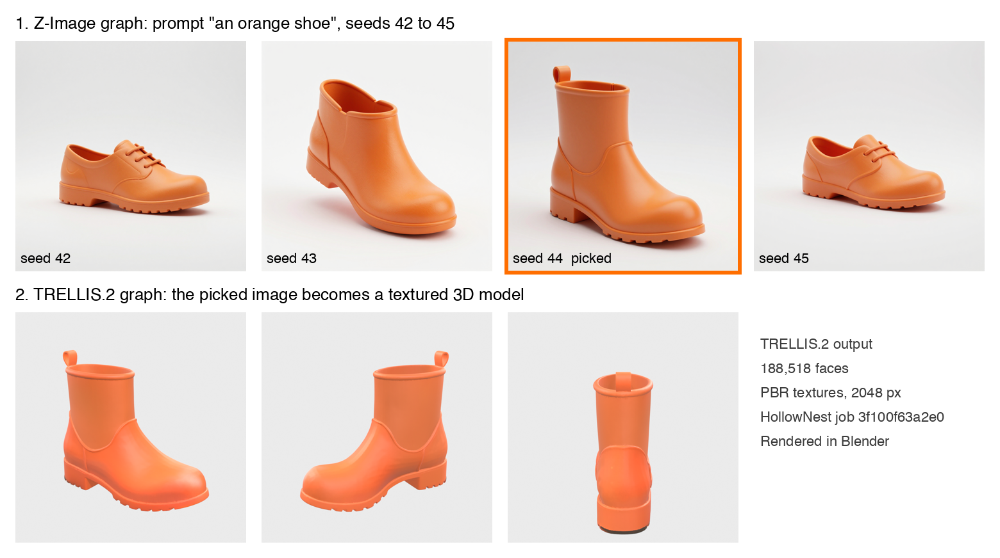
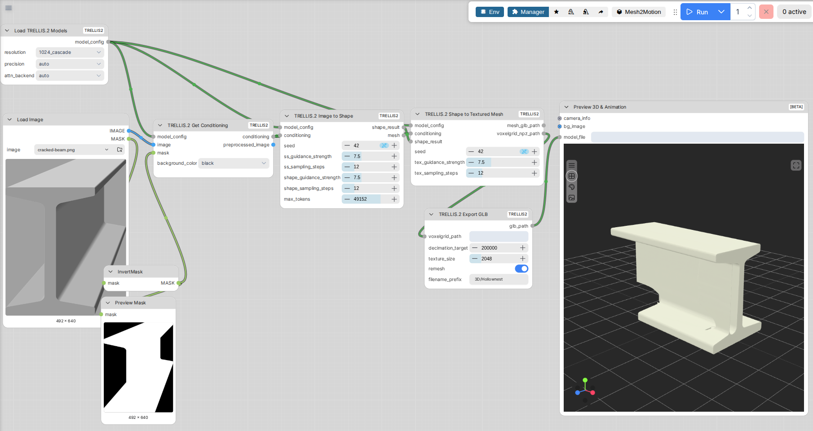

# HollowNest ComfyUI Workflow

HollowNest is a 3D asset library I built for researchers at Kennesaw State University. Its Generate page turns a text prompt or a photo into a textured 3D model. These are the ComfyUI graphs that run behind it on our NVIDIA DGX.

**Live site:** https://hollownest-one.vercel.app/generate

## The graphs I built

My backend builds each graph in Python and sends it to ComfyUI's API. It checks which nodes are installed on the DGX and picks the 3D branch to match.

| File | Nodes | What it does |
|---|---|---|
| `01_text_to_image_zimage_seed_sweep.json` | 8 | Z-Image Turbo turns the prompt into a product-style reference image. The site runs it at seeds 42 to 45 so the user gets four options. |
| `02_image_to_3d_trellis2.json` | 8 | TRELLIS.2 turns the picked image into a 3D model with PBR textures. This is the branch that made the model above. |
| `03_image_to_3d_hunyuan3d_fallback.json` | 23 | Hunyuan3D runs only if TRELLIS.2 isn't installed. It cleans the image, builds the mesh, removes baked lighting, and bakes the texture from six cameras I set up. |

This is the TRELLIS.2 graph on the ComfyUI canvas, with a cracked steel beam from a KSU engineering project as input. The settings match `02_image_to_3d_trellis2.json`. In this version the input image is already cut out, so the mask comes straight from its alpha channel. The site version adds the rembg nodes instead, because uploaded photos still have their backgrounds.

**To inspect them:** drag any of the JSON files into ComfyUI. They're in API format, so ComfyUI will lay the nodes out automatically.

**Node packs needed:**

- **[ComfyUI-TRELLIS2](https://github.com/PozzettiAndrea/ComfyUI-TRELLIS2)** for the main 3D graph.
- **[ComfyUI_essentials](https://github.com/cubiq/ComfyUI_essentials)** for background removal and resizing.
- **[ComfyUI-Hunyuan3DWrapper](https://github.com/kijai/ComfyUI-Hunyuan3DWrapper)** for the fallback graph.

**Key settings:**

- **Z-Image:** 8 steps, CFG 1.0, 1024 by 1024. Every prompt gets the same style suffix: white background, studio lighting, single centered object.
- **TRELLIS.2:** 1024 cascade resolution, 12 steps per stage, guidance 7.5. It exports a GLB at up to 200,000 faces with 2048 px textures.
- **Background removal:** I replaced TRELLIS.2's built-in background remover with the rembg nodes. The built-in one threw data type errors on the DGX's ARM chip.

## The problem it solves

KSU researchers need 3D models of their work for exhibits and AR, but most of them have never used 3D software. Typing a prompt into an image-to-3D tool gives you one roll of the dice. If the image is wrong, the model is wrong, and you wait minutes to find out.

HollowNest splits the job in two. First it shows four quick images to choose from. Then it spends the expensive 3D step only on the one you picked.

## Output

The figure at the top is real output from the live site.

1. **Prompt:** "an orange shoe."
2. **Four seeds:** two lace-up shoes, an ankle bootie, and a pull-tab rain boot.
3. **The pick:** seed 44, the rain boot.
4. **The 3D model:** HollowNest job `3f100f63a2e0`, 188,518 faces, 2048 px PBR textures. I rendered it in Blender from three angles.

`seed_sweep.png` shows the same four-seed sweep for three prompts. The fire hydrant stays consistent across seeds. The shoe changes completely.

**What a prompt box can't give you:**

- **A choice before the 3D step.** You see four options and pick one before spending GPU time.
- **Repeatable results.** Fixed seeds mean the same prompt gives the same four images every time.
- **A fixed house style.** Every reference image gets the same lighting and background, so the 3D step gets clean input.
- **Hardware-aware routing.** The same request runs TRELLIS.2 or Hunyuan3D depending on what's installed.

## What I'd change

- **Add a quality check before saving.** One of my test objects, a stone, came out with a strange shiny texture and still got saved.
- **Record which branch made each model.** To write this up, I had to work out which graph made the outputs from their face counts. The asset record should store it.
- **Keep one copy of the graph.** The site and my pipeline repo each have their own copy, and they've drifted apart.
- **Let users change the style suffix.** "Museum exhibit, stylized" works for research props but not for every object.
